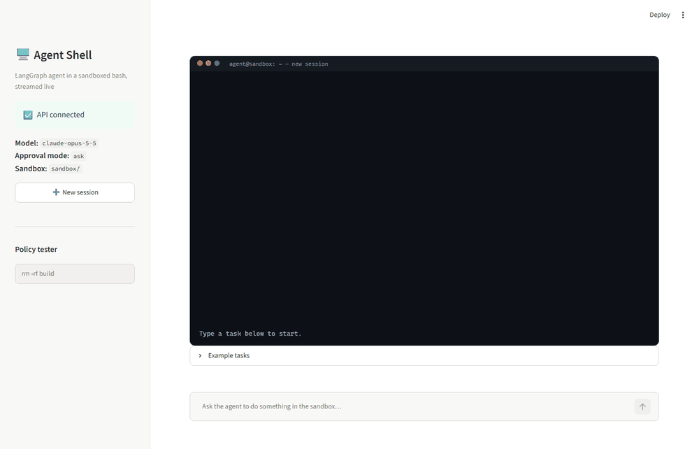
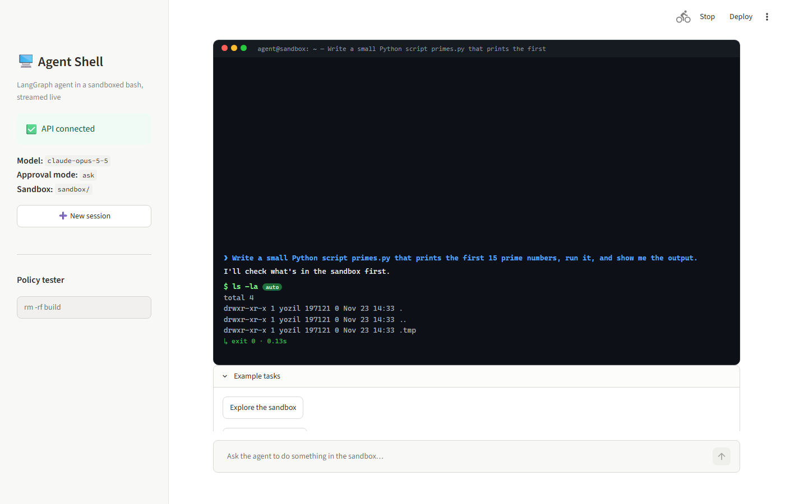
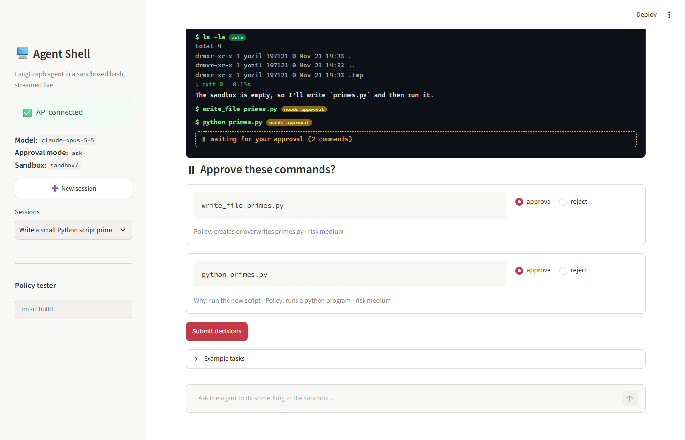
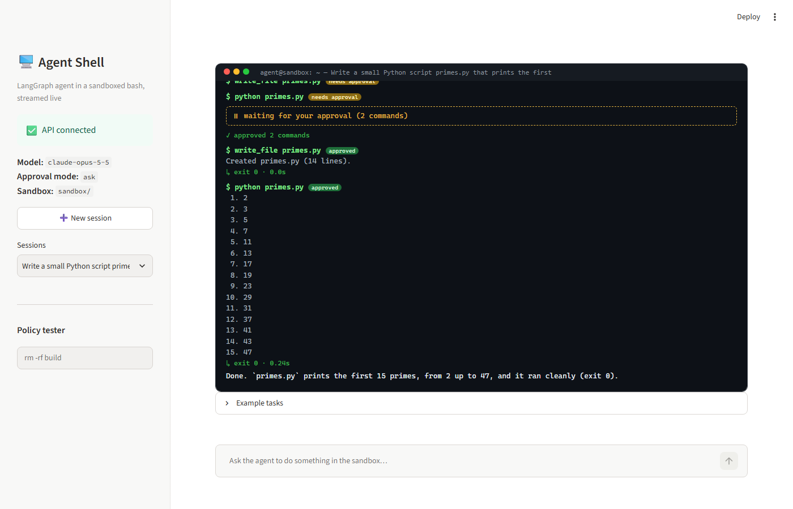
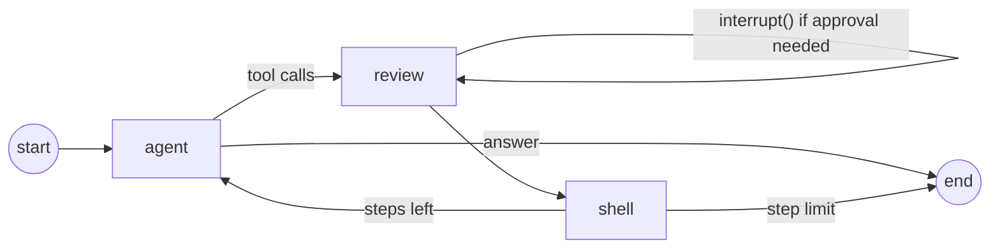

# Streaming Agent Shell

[](https://github.com/yordanossimegnew/streaming_agent_shell/actions/workflows/tests.yml)

An AI agent that works in a terminal. You give it a task, and it runs bash commands in a
sandbox folder. **Claude's reply streams token by token, and every command's output streams line
by line**, live, into a terminal-style UI. Read-only commands run on their own. Anything that
changes state **pauses the graph until you approve it**, and dangerous commands are refused.

Built with **LangGraph** (interrupts and a checkpointer for human-in-the-loop approval) and
**LangChain**, served by **FastAPI** with Server-Sent Events, plus a **Streamlit** terminal UI.



<sub>Demo uses scripted model replies; the shell, sandbox, command output and approvals are real.</sub>

| Live streaming | Approval gate | Result |
|---|---|---|
|  |  |  |

## Features

- **Two live streams, merged into one:**
  - Claude's text arrives token by token (LangGraph `stream_mode="messages"`).
  - Shell output arrives line by line while the command is still running (`stream_mode="custom"`
    via `get_stream_writer()`).

  Both reach the browser over Server-Sent Events.
- **Human-in-the-loop with LangGraph `interrupt()`:**
  - Risky commands pause the graph, and the SQLite checkpointer saves its state.
  - Your decision resumes it with `Command(resume=...)`, even minutes later.
  - Several commands in one step become one approval card each.
- **Command policy:**
  - `allow`: read-only commands (`ls`, `cat`, `grep`, `git status`...) run immediately.
  - `ask`: commands that write files, install packages, run code or use the network need approval.
  - `deny`: commands are refused outright if they are privilege escalation, `curl | sh`,
    remote access, disk tools or process killing, or if they touch paths outside the sandbox
    (absolute paths, `~`, `../..`, `C:\...`).
- **Approval modes:** `ask` (default), `auto` (approve automatically), `readonly` (refuse anything
  that isn't read-only).
- **Sandboxed execution:**
  - The working directory is `sandbox/`.
  - Commands get a **stripped environment**, so `ANTHROPIC_API_KEY` and other secrets never reach them.
  - There's a timeout that kills the whole process tree.
  - In Docker, commands run as a non-root user with all capabilities dropped.
- **Multi-turn sessions:** each session is a LangGraph thread, so the agent remembers earlier
  turns and you can keep going.
- **Terminal-style Streamlit UI** with a blinking cursor, policy badges (`auto` /
  `needs approval` / `refused`), approval cards, session switching and a live **policy tester**.
- **Interactive CLI** with the same streaming and approval prompts.
- **57 offline tests:** the policy, a real bash runner, interrupt/resume, and SSE. A scripted
  LangChain chat model streams tokens just like `ChatAnthropic`.

## Project structure

```
streaming-agent-shell/
├── README.md
├── requirements.txt
├── .env.example            # copy to .env (never commit .env)
├── .gitignore
├── Dockerfile              # non-root user, bash + git
├── docker-compose.yml      # API (capabilities dropped, pids/mem limits) + UI
├── main.py                 # FastAPI app (`main:app`) + interactive terminal CLI
├── ui/
│   └── app.py              # Streamlit terminal UI with approval cards
├── docs/                   # demo.gif + screenshots
├── sandbox/                # the agent's working directory
├── src/
│   ├── agent/
│   │   ├── agent.py        # LangGraph graph: agent -> review (interrupt) -> shell
│   │   ├── runner.py       # runs a turn; merges messages/custom/updates streams into events
│   │   ├── state.py        # graph state (messages, steps, verdicts), token usage
│   │   └── memory.py       # SQLite checkpointer (powers interrupt/resume)
│   ├── tools/
│   │   ├── policy.py       # allow / ask / deny classification of commands
│   │   ├── shell.py        # streaming subprocess runner, env stripping, timeouts
│   │   ├── files.py        # write_file confined to the sandbox
│   │   └── __init__.py     # tool definitions + review()
│   ├── models/
│   │   └── llm_client.py   # LangChain ChatAnthropic (effort, caching, refusal fallback)
│   ├── prompts/            # system prompt + knowledge base assembly
│   ├── utils/              # config (env/.env), logging, helpers
│   └── api/
│       ├── sessions.py     # sessions, background turns, event log
│       ├── routes.py       # FastAPI endpoints incl. SSE stream and approvals
│       └── schemas.py      # Pydantic models
├── tests/
│   ├── fakes.py            # streaming scripted chat model (a real LangChain BaseChatModel)
│   ├── test_policy.py      # 40+ allow/ask/deny cases incl. false-positive checks
│   ├── test_tools.py       # live line streaming, exit codes, timeouts, env stripping
│   ├── test_agent.py       # interrupt -> approve/reject -> resume, modes, step limit
│   └── test_api.py         # sessions, SSE, approvals, 409/422 errors
├── data/
│   ├── examples.json       # sample tasks
│   └── knowledge_base/     # shell guidelines injected into the system prompt
└── logs/
```

## Setup

```bash
cd streaming-agent-shell
python -m venv .venv
# Windows: .venv\Scripts\activate   |   macOS/Linux: source .venv/bin/activate
pip install -r requirements.txt
cp .env.example .env              # then put your ANTHROPIC_API_KEY in .env
```

Commands run in **bash**: on Linux/macOS the system bash, on Windows **Git Bash** (detected
automatically; override with `SHELL_EXECUTABLE`).

## Run the API

```bash
uvicorn main:app --reload         # or: python main.py      ->  http://localhost:8000/docs
```

| Method | Path                             | Description                                                     |
|--------|----------------------------------|-----------------------------------------------------------------|
| GET    | `/health`                        | Model, shell, sandbox, approval mode                            |
| GET    | `/policy/check?command=…`        | Dry-run the policy on a command (nothing executes)              |
| POST   | `/sessions`                      | Create a session (a LangGraph thread)                           |
| POST   | `/sessions/{id}/messages`        | Start a turn → `{stream_url}`                                   |
| GET    | `/sessions/{id}/stream?start=N`  | **Server-Sent Events**: tokens, commands, output lines, approvals |
| POST   | `/sessions/{id}/approval`        | Resume a paused turn: `{"decisions": {"<id>": "approve"}}`      |
| GET    | `/sessions/{id}`                 | Status, pending approvals, full event log                       |
| GET    | `/sessions/{id}/transcript`      | Message history from the checkpointer                           |
| GET    | `/sessions`                      | All sessions                                                    |

A turn's event stream looks like this:

```
data: {"type": "user", "text": "Write primes.py and run it"}
data: {"type": "token", "text": "I'll "}
data: {"type": "token", "text": "check "}
data: {"type": "tool_call", "id": "c1", "name": "run_command", "args": {"command": "ls -la"}, "effective": "allow", ...}
data: {"type": "command_start", "call_id": "c1", "command": "ls -la"}
data: {"type": "output", "call_id": "c1", "line": "total 4"}
data: {"type": "command_done", "call_id": "c1", "exit_code": 0, "duration": 0.13, "timed_out": false}
data: {"type": "tool_call", "id": "c2", "args": {"command": "python primes.py"}, "effective": "ask", ...}
data: {"type": "approval_required", "pending": [{"id": "c2", "reason": "runs a python program", "risk": "medium"}]}
data: {"type": "turn_done", "status": "awaiting_approval", ...}
```

## Run the Streamlit UI

With the API running, in a second terminal:

```bash
streamlit run ui/app.py           # http://localhost:8501
```

## Terminal CLI

```bash
python main.py cli
you ❯ write a script that prints the first 15 primes and run it
```

## Docker

```bash
docker compose up --build         # API on :8000, UI on :8501
```

The container is the real security boundary. The agent runs as an unprivileged user with
capabilities dropped, a process limit and a memory limit, and only `./sandbox` is shared with
your machine.

## Tests

```bash
pytest -q
```

## Configuration

| Variable                | Default           | Meaning                                         |
|-------------------------|-------------------|-------------------------------------------------|
| `AGENT_MODEL`           | `claude-opus-5-5` | Claude model id                                 |
| `AGENT_EFFORT`          | `high`            | Thinking depth: `low` … `max`                   |
| `AGENT_MAX_STEPS`       | `25`              | Max model calls per turn                        |
| `SHELL_SANDBOX`         | `./sandbox`       | The agent's working directory                   |
| `SHELL_EXECUTABLE`      | auto (bash)       | Shell used to run commands                      |
| `SHELL_COMMAND_TIMEOUT` | `60`              | Seconds before a command is killed              |
| `SHELL_APPROVAL_MODE`   | `ask`             | `ask` · `auto` · `readonly`                     |

## How the graph works



1. **`agent`:** Claude (`ChatAnthropic`, tools bound) streams its reply. Each proposed command
   is classified by the policy and announced as a `tool_call` event.
2. **`review`:** applies the policy and approval mode. If anything needs approval it calls
   `interrupt({"pending": [...]})`, and the graph stops with its state checkpointed. The node has
   **no side effects**, so it is safe for LangGraph to re-run it when the graph resumes.
3. **`shell`:** runs approved commands and streams each output line with `get_stream_writer()`.
   Refused or rejected commands go back to Claude as error results so it can adapt.
4. The runner merges LangGraph's `messages`, `custom` and `updates` streams into one event
   stream, and the API serves it as SSE.

## Ideas to extend

- Per-session Docker containers instead of a shared sandbox folder.
- "Always allow this command" approvals stored per session.
- A Rust or Go terminal client that consumes the SSE stream.
